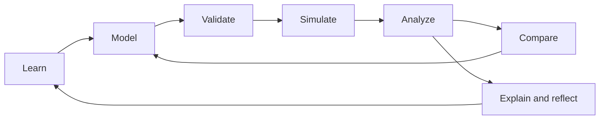
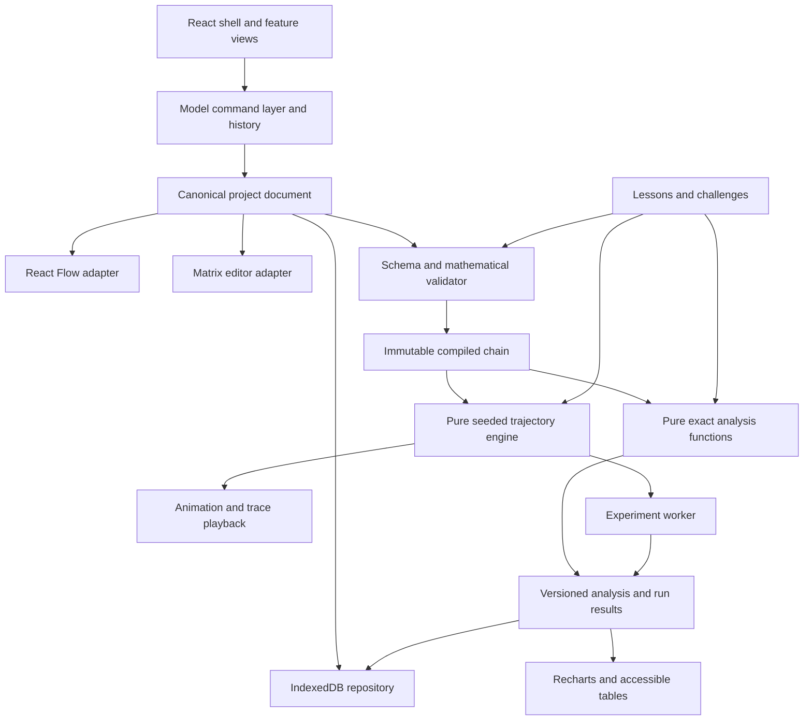

# Markov Chain Simulator — Upgrade Plan

> Agent-ready implementation contract. Upgrade the existing application incrementally. Read this file together with `STYLE.md`; this file governs behavior, mathematics, architecture, and delivery, while `STYLE.md` governs visual design and interaction. No application code was inspected when preparing these specifications, and no implementation milestone is asserted complete.

## 1. Sources, scope, and working rules

### 1.1 Source authority

| Reference supplied by the user | What this plan transfers | What it does not establish |
| --- | --- | --- |
| `README(2).md` | Current Markov features, examples, user workflows, and React/TypeScript/Vite/React Flow/Recharts/Lucide/CSS stack | Actual component names, dependency versions, algorithms, storage behavior, or test coverage |
| `PLAN(8).md` | Learn → Model → Validate → Simulate → Analyze → Improve cycle; seven functional modules; staged delivery; separation of engines; reproducibility; local-first storage; educational assessment; implementation ownership | BPMN completion checkboxes do not mean Markov features are implemented |
| `STYLE(7).md` | Implemented BPMN Studio tokens, typography, dimensions, responsive layouts, component recipes, chart treatment, and theme behavior | Source repository files mentioned there were not supplied; its accessibility recommendations are not existing guarantees |

Preserve the product name **Markov Chain Simulator** unless the repository or owner specifies otherwise. Do not silently rename it BPMN Studio or introduce BPMN packages. Replace the existing glassmorphism with the supplied compact analytical design while preserving functionality.

**Priority vocabulary:** MUST = release requirement for its assigned phase; SHOULD = preferred implementation with a documented alternative allowed; LATER = explicitly deferred. All checklists below start unchecked. Record completed work only after code and verification exist.

### 1.2 First implementation actions

1. Read repository instructions and inspect the source, package manifest, lockfile, build setup, tests, examples, and persistence code.
2. Run the existing install/build/test workflow using the repository's package manager. Record baseline failures separately from new failures.
3. Create `docs/current-state-audit.md` with component/algorithm/storage maps, screenshots of current workflows, existing data formats, and the preservation matrix in §2.
4. Extract the four existing examples as fixtures without changing their names, topology, probabilities, descriptions, or layouts. Verify their mathematics; document defects and migrate corrected versions transparently.
5. Agree implementation interfaces in code and record decisions in `docs/architecture/`. Retain working components and dependencies. Do not reset the project or broadly update packages to modernize appearance.
6. Implement the first vertical slice: open Weather → edit one matrix cell → see graph update → receive validation → compute one distribution step → save/reopen → verify both themes.

### 1.3 Product boundary

The core is a **finite-state, discrete-time, time-homogeneous Markov chain** with a row-stochastic transition matrix. One step is a discrete index; it is not inherently a second or a day. Scenarios may supply a documented step label such as “day.”

The upgrade supports students learning probability, stochastic processes, and modeling. It combines visual construction, explanatory calculations, reproducible random experiments, and guided challenges. Computation remains local; a backend, login, cloud storage, AI tutor, collaboration, continuous-time chains, hidden Markov models, MDPs, optimization solvers, and population epidemic engines are outside the required release.

A future extension must declare its own semantics and capabilities. Never imply that an animation is a separate scientific simulation engine or that finite-horizon data establishes an asymptotic theorem.

## 2. Existing-feature preservation contract

The README is the baseline feature inventory. Audit and test each item before refactoring.

| ID | Existing capability | Required preservation and enhancement | Verification |
| --- | --- | --- | --- |
| B01 | Curved floating arcs with bidirectional “eye” separation | Preserve two distinct directed edges, arrowheads, label placement, endpoint tracking on drag; add readable self-loops | Visual regression with A↔B, self-loop, renamed/dragged states |
| B02 | Add any number of draggable states | Preserve dynamic creation and positions; no arbitrary small hard cap; publish measured computation limits separately | Add/drag/reload/reorder a model beyond the seven-state example |
| B03 | Double-click inline renaming | Preserve mouse workflow; add keyboard-accessible rename; identity uses stable IDs | Rename without changing matrix ordering or path references |
| B04 | Connect by dragging from a state's center | Preserve gesture through React Flow configuration/custom handles; provide keyboard/form alternative | Create A→B and A→A without accidental duplicate transitions |
| B05 | Live editable transition matrix synchronized with graph | One canonical probability value per ordered state pair; graph and matrix dispatch the same commands | Both directions, undo/redo, state deletion, zero probability |
| B06 | Automatic row-sum validation | Preserve immediate feedback; show row sum, deficit/excess, linked cells and safe repairs | Invalid rows block new computations without discarding work |
| B07 | Sequence/joint probability calculator | Preserve click-to-build path and exact-model calculation; clarify joint versus conditional mode and initial distribution | §4.3 fixtures, zero-probability paths, long paths |
| B08 | Stationary distribution | Preserve analysis entry point; show class-based results and convergence qualifications | Periodic, reducible, absorbing, and one-state fixtures |
| B09 | State-distribution chart over time | Preserve analytic evolution; explicitly distinguish sampled estimates and empirical visit frequencies | Correct `t=0`, conservation, chart/table equality |
| B10 | Theory quick reference | Preserve Markov property, matrices, absorbing states, and existing explanations; link to richer lessons | Contextual links and keyboard navigation |
| B11 | Weather Model, Casino Heist, The Doomscroll Trap, SIR Epidemic Model | Preserve all four and original content; add learning metadata and limitations | Load all four, validate, simulate, analyze, save/reopen |
| B12 | “+ Add State,” “Transition Matrix,” “Sequence Probability Calculator,” “New Model” flows | Keep recognizable labels or obvious aliases; protect unsaved work on replacement | End-to-end beginner walkthrough |
| B13 | Existing stack and commands | Retain React, TypeScript, Vite, `@xyflow/react`, Recharts, Lucide React, vanilla CSS; retain `npm run dev` / `npm run build` if npm is actual manager | Production build and feature regression |

“Preserve” means preserve user capability and saved work, not perpetuate a mathematical defect. Correct defects with tests, migration notes, and clear UI explanations. Do not claim a feature exists merely because it appears in the target specification.

## 3. Learning cycle and information architecture



### 3.1 Navigation

| Group | Destination | Purpose |
| --- | --- | --- |
| Workspace | Overview | Continue last model, recent projects, quick actions, progress |
| Workspace | Modeler | Graph, matrix, initial distribution, validation, sequence calculator |
| Workspace | Simulation | Animated trajectory and exact distribution exploration |
| Workspace | Experiments | Independent trajectories, experiment configuration, estimates |
| Workspace | Analysis | Structure, stationary behavior, absorption, first passage, rewards |
| Workspace | Compare | Baseline and alternative models/results |
| Learn | Lessons, Challenges, Examples, Theory | Guided content and independent exploration |
| Utility | Settings, Help | Theme, display precision, data export/reset, support information |

Routes are implementation targets, not assertions about current routing. Add a lightweight routing solution only if needed. Opening a model from any destination sets one shared active project. Navigation must not reset simulations or edits unexpectedly. Keep essential tools discoverable in the modeler before expanding navigation into separate pages.

### 3.2 Workspace composition

Use the exact shell in `STYLE.md`: 232px expanded navigation, 64px collapsed navigation, 56px toolbar, canvas plus 420px inspector. Inspector tabs: **Matrix**, **State**, **Validate**, **Sequence**, **Explain**. Exact distribution charts can appear in an expandable lower panel or the Simulation page; avoid permanently stacking every tool into a cramped inspector.

On selection, show the state/transition name, mathematical meaning, outgoing row, classification when available, typical mistakes, related lesson, and a small interactive demonstration. Selecting a matrix cell highlights the same graph edge; selecting an edge focuses its probability field. Display model revision and stale-result status without overwhelming beginners.

## 4. Mathematical and numerical contract

### 4.1 Definitions and orientation

For ordered states `S = [s₀, …, sₙ₋₁]`, define:

- `P[i][j] = Pr(Xₜ₊₁ = sⱼ | Xₜ = sᵢ)`.
- Every entry is finite, real, and in `[0,1]`; every row sums to 1.
- `μ₀` is a row probability vector in the same state order.
- `μₜ₊₁ = μₜ P` and `μₜ = μ₀ Pᵗ`, with `P⁰ = I`.
- `(Pᵏ)[i][j]` is the probability of being in `j` after exactly `k` steps from `i`; it is not generally a first-arrival probability.
- `Pᵃ⁺ᵇ = PᵃPᵇ` is a testable invariant.

These conventions follow the standard row-vector treatment described in [James Aspnes's Yale Markov-chain notes](https://www.cs.yale.edu/homes/aspnes/pinewiki/MarkovChains.html). The implementation requirements and numerical policies below are specific to this upgrade.

Always label rows **From** and columns **To**. Show the initial distribution explicitly. A selected starting state is a point mass, not a different interpretation of the matrix. The model is incomplete with zero states. A one-state valid model has `P=[[1]]`, `μ₀=[1]`.

### 4.2 Input, validation, and precision

1. Store full binary64 numeric values, not rounded display strings. Keep partially typed strings in local edit buffers. Empty cells, a standalone minus sign, or incomplete exponents are drafts, not zero.
2. Accept plain decimals and finite scientific notation. A later fraction parser may be added with a strict grammar; never evaluate text as code. Percent formatting is a display option; unmarked input is always in `[0,1]`.
3. Reject nonfinite values, negatives, values above 1, duplicate IDs, missing endpoints, inconsistent dimensions, and invalid initial distributions. Imported numbers receive the same validation as edited numbers.
4. Use compensated summation for row/distribution sums. Set a documented default absolute row-sum tolerance `εrow = 1e-12`, numerical residual target `εsolve = 1e-10`, and display precision 4 decimal places. These have different roles; none changes graph reachability.
5. A nonzero sum discrepancy within `εrow` is a floating-point discrepancy. Compilation may divide that row by its recorded sum, keeping zero entries zero; record this adjustment in numerical diagnostics. Apply the same rule to `μ₀`. All engines use the same compiled snapshot. Larger discrepancies block computation until an explicit repair.
6. Offer **Normalize row** only for a finite, nonnegative row with positive sum; preview changes and make the operation undoable. For a zero row, offer **Make absorbing** or **Distribute equally**, never silent division by zero. A separate **Fill remainder in this cell** is available only when the remaining mass is in `[0,1]`.
7. Out-of-range inputs are not repaired by normalization. No automatic redistribution while typing, creating an edge, or deleting a state.
8. Graph support uses every strictly positive compiled probability. Do not discard rare transitions using rounding, solver tolerance, or a chart visibility threshold. A visual “hide tiny edges” option must say analysis is unchanged.
9. Solvers must return method, residual, warnings, and status. Small negative numerical artifacts may be clamped only within a documented solver tolerance, followed by renormalization and residual revalidation; otherwise report failure. Never conceal an ill-conditioned solve behind apparently precise output.
10. Scientific notation or a “less than display precision” indicator must distinguish tiny positive probabilities from actual zero. Export full precision; localize display only.

### 4.3 Sequence probability

For a path `x₀, …, xₖ` with `k` transitions:

```text
Joint:       Pr(X₀=x₀,…,Xₖ=xₖ) = μ₀[x₀] × ∏(r=0…k−1) P[xᵣ,xᵣ₊₁]
Conditional: Pr(X₁=x₁,…,Xₖ=xₖ | X₀=x₀) = ∏(r=0…k−1) P[xᵣ,xᵣ₊₁]
```

The conditional option explicitly sets the start state for that query; if interpreted under a `μ₀` assigning it zero mass, explain that this is a counterfactual start-state calculation, not conditioning on a positive-probability event. A one-state path has joint probability `μ₀[x₀]` and conditional product 1. An empty selection displays instructions, not a misleading numerical answer. Missing/zero transitions give exactly zero and identify the first impossible step.

Show a factor-by-factor explanation and log probability. Compute long products through sums of logs; zero factors produce `−∞` log probability. Underflow must show a positive probability below numerical display range, not “impossible.” “Exact” means analytical model calculation evaluated numerically, not arbitrary-precision arithmetic. Export method and numerical precision.

### 4.4 Structural analysis

Build a directed support graph using `Pij > 0`. Use strongly connected components (Tarjan or Kosaraju) to identify communicating classes. A class is closed when no positive-probability edge leaves it. In a finite chain, closed communicating classes are recurrent and other states transient. A chain is irreducible exactly when there is one communicating class.

A state is absorbing only when its self-loop has probability 1 and all other outgoing entries are zero in the compiled matrix. A closed class with several states is recurrent but not a single absorbing state. Unreachable-from-`μ₀` states are informative, not inherently invalid; a valid reducible or periodic chain must remain runnable.

For each recurrent class, compute the period as the gcd of directed cycle lengths. An implementable linear graph method uses integer traversal depths and the gcd of `depth(u)+1−depth(v)` over all edges inside the strongly connected class, taking absolute values. A positive self-loop forces period 1. Mark transient acyclic singleton period as not applicable. Never infer aperiodicity solely from a finite simulated trace.

### 4.5 Stationary distributions and long-run behavior

A stationary vector satisfies `πP=π`, `π≥0`, and `Σπ=1`. Finite chains have at least one stationary distribution; irreducible finite chains have exactly one. Uniqueness does not require aperiodicity. See [Gautam Iyer's CMU notes on stationary distributions](https://www.math.cmu.edu/~gautam/c/2025-326/notes/markov2-stationary.html).

Required algorithm and UI behavior:

- Find closed classes first. Solve one normalized stationary vector for each class and extend it by zeros outside the class. Solve a constrained linear system using pivoting or a rank-revealing method; replace a dependent equation with normalization. Do not use naive power iteration as the only solver.
- With multiple closed classes, show the extremal vectors and explain that any convex mixture is stationary. A chain with transient states and exactly one closed class can still have a unique stationary distribution.
- Compute eventual class-entry weights from `μ₀` using transient-to-class hitting probabilities, adding mass initially inside each class. These weights identify the relevant stationary mixture for the initial distribution.
- Ordinary `μₜ` convergence is guaranteed if all closed classes reachable from `μ₀` are aperiodic. Periodicity removes that general guarantee, but special initial distributions, including a stationary one, may still converge. Do not state that every periodic chain oscillates from every initial distribution.
- If the general convergence condition is absent, show **Stationary distribution exists; convergence is not guaranteed** and demonstrate finite-step behavior. Do not invent a “limiting distribution” from the last iterate.
- Cesàro averages `T⁻¹ Σ(t=0…T−1) μₜ` converge to the class-weighted stationary mixture for finite chains. A single trajectory eventually enters one recurrent class; its empirical occupation frequencies can differ from the ensemble mixture. Explain this when there are several closed classes.
- Report `||πP−π||₁`, normalization error, solver method, and any numerical limitation. Iterative diagnostics have iteration/time caps and a distinct **not converged numerically** status.
- Plot total variation distance `TV(μₜ,π)=½Σᵢ|μₜ[i]−π[i]|` only when the chosen reference vector is identified. A finite-horizon threshold crossing is not automatically the worst-case mixing time. A separate advanced mixing calculation must state its assumptions and maximize over start states when that is the intended definition.

### 4.6 Absorption and visits

For a chain in which all transient states eventually reach absorbing states, reorder a computation-only copy as:

```text
P = [ Q  R ]       N = (I−Q)⁻¹
    [ 0  I ]       B = N R             t = N 1
```

`Nij` is the expected number of visits to transient state `j`, including time 0 when applicable, before absorption; `Bia` is eventual absorption probability in absorbing state `a`; `ti` is expected transitions to absorption. Starting in an absorbing state gives time 0 and its point-mass absorption outcome. These identities are covered in [Grinstead and Snell, Chapter 11, §11.2](https://math.ucdavis.edu/~tracy/courses/math135B/snell.pdf).

Implementation requirements:

- Confirm the structural precondition before using this absorbing-chain presentation. A graph with an absorbing state and a separate closed cycle does not satisfy it globally.
- Solve `(I−Q)B=R` and `(I−Q)t=1`; do not explicitly invert a matrix merely to compute these outputs. If the visits matrix is requested, solve against identity using the same factorization.
- Optional variance: solve `v=(2N−I)t−t⊙t` through linear solves and label units as steps squared.
- General closed-class entry analysis treats whole recurrent classes as terminal outcomes and labels them as such; it must not claim each member is an absorbing state.
- Report large expected times, residuals, and conditioning warnings. Near-absorbing loops can be numerically difficult. No finite iteration cutoff may masquerade as proof of infinite expectation.

### 4.7 Hitting, first passage, and recurrence

For a target set `A`, define `T_A = inf{t≥0: Xₜ∈A}`. A start in `A` gives zero. First return is a separate concept `T_A⁺ = inf{t≥1: Xₜ∈A}`; never mix them in one KPI.

- Compute hitting probabilities `hᵢ=Prᵢ(T_A<∞)` with `h=1` on `A`, `h=0` where `A` is unreachable, and `hᵢ=ΣⱼPij hⱼ` elsewhere. Use a target-stopped graph and its class structure to identify boundary conditions before solving; a singular unconstrained system is not a solution.
- If `hᵢ<1` structurally, the unconditional expected hitting time is infinite. Decide almost-sure reachability by closed-class structure in the stopped chain, not by rounding `h` to 1. Solve `mᵢ=1+ΣⱼPij mⱼ`, with `m=0` on `A`, only on states from which hitting is almost sure. Return explicit infinity for others.
- If adding conditional time given eventual hitting, label it separately and use the conditioned transition kernel `P*ij=Pij hⱼ/hᵢ` for positive `hᵢ`, with target absorbing. Do not display conditional time when `hᵢ=0`.
- Compute first-arrival probabilities within a horizon with target-killed propagation: initial outside-target mass `v₀=μ₀|Aᶜ`, first-hit mass at step `t≥1` is `vₜ₋₁ P[Aᶜ,A]1`, and `vₜ=vₜ₋₁ P[Aᶜ,Aᶜ]`. Include initial target mass at step 0. Occupancy at step `t` is a different result.
- For a state in a finite recurrent irreducible class, mean return time is `1/πᵢ` using that class's normalized stationary distribution. Do not apply the reciprocal to a transient state or an arbitrary mixture weight.

### 4.8 Rewards and optional advanced analysis

Phase 5 MAY include a finite-horizon additive reward model. Declare whether rewards occur on state occupancy or transitions and when they are earned. Default state reward total over `H` steps is `Σ(t=0…H−1) μₜ r`; a start-only horizon `H=0` earns zero. Transition rewards use `Σ(t=0…H−1)Σᵢⱼ μₜ[i]Pij rᵢⱼ`. A reward on entering an absorbing state is paid once only when explicitly specified; an ongoing reward in it is different.

Keep mixing diagnostics, entropy, sensitivity, and automatic optimization LATER unless their definitions, assumptions, tests, and teaching value are implemented. Row-sum-preserving parameter sweeps are useful without claiming global optimality.

## 5. Functional modules

### Module A — Interactive modeler

**MUST preserve:** draggable dynamic states, center-drag connections, floating bidirectional arcs, inline renaming, live matrix, all current examples, sequence calculator, New Model.

**MUST add incrementally:** stable IDs; add/delete transitions and self-loops; selection inspector; keyboard alternatives; undo/redo; zoom/pan/fit; duplicate model; explicit initial distribution; local saved projects; autosave status; JSON import/export; validation links; light/dark/system themes.

Editing rules:

- One mathematical transition per ordered pair. Drawing an existing pair selects it. Represent a newly drawn edge as a draft awaiting a positive probability; it is not a mathematical edge until committed. Setting an existing probability to zero removes the mathematical edge while retaining the zero matrix cell.
- New states get a self-loop of 1 and initial mass 0 when a nonempty model exists. The first new state gets initial mass 1. Document these defaults in the creation hint; they preserve validity without changing old rows.
- Deleting a state removes its row/column and references in one undoable command. If it removes probability or initial mass, show affected rows and require explicit repair. Clear or flag sequences/targets that reference it; never silently retarget them by array index.
- Reordering states reorders all indexed views consistently. IDs survive renaming and ordering. Dragging updates only layout and must not invalidate mathematical results.
- “New Model” creates a recoverable empty project after saving or explicitly discarding current edits. Example loading offers opening a new project rather than overwriting saved work.
- State identity and color remain stable across graph, matrix, traces, charts, exports, and comparison mappings.

### Module B — Learning and theory

Use the BPMN learning structure: brief explanation → visual example → interactive demonstration → common mistake → exercise → knowledge check. Every lesson has prerequisites, one observable objective, resettable example, accessible text alternative, estimated effort, and next step.

| Level | Modules | Required learner outcome |
| --- | --- | --- |
| 1. Foundations | States, Markov property, time steps, rows, self-loops | Build and validate a two-state model; explain `Pij` |
| 2. Evolution | Initial distribution, one-step/n-step evolution, paths | Distinguish a specific path from all paths ending in a state |
| 3. Long-run behavior | Stationary vectors, irreducibility, periodicity, communicating classes | Explain why stationary need not mean convergent |
| 4. Absorption | Transient states, absorbing outcomes, expected visits, first passage | Separate eventual absorption, occupancy, and time to reach a target |
| 5. Experiments | Seeds, independent replications, uncertainty, censoring, comparisons | Compare estimates to exact calculations and explain limitations |

Lessons must be structured data with stable IDs and versioned fixtures. Track local completion, attempts, hints used, and conceptual objectives; do not gate the modeler behind scores. Badges are optional and subordinate to explanatory feedback. No opaque automatic grading of free-text reasoning; use a rubric and sample explanation or instructor review.

### Module C — Validation and explanation

Separate four layers: document/schema validity; stochastic mathematical validity; algorithm capability/numerical feasibility; educational recommendations. A mathematically valid chain may be unsupported for an expensive analysis but still runnable.

| Severity | Example | Effect |
| --- | --- | --- |
| Error | Row totals 1.2; invalid `μ₀`; missing endpoint | Block dependent computation; keep editing/save/export available |
| Warning | Ill-conditioned solve; truncated experiment; large workload | Explain limitation; allow only results whose meaning remains valid |
| Recommendation | Unnamed state, crowded labels, unexplained step units | Suggest improvement without altering model semantics |
| Information | Reducible chain; two closed classes; periodic class | Teach consequences; do not treat these valid properties as errors |

Each issue has stable code, severity, affected state/transition/cell, title, explanation, consequence, proposed correction, lesson link, and optional explicit undoable repair. Provide a summary plus click-to-focus. Debounce expensive checks; cheap row checks are immediate. When invalid input exists, disable new dependent runs and mark prior results as from an earlier valid revision.

### Module D — Animated trajectory and exact evolution

Use two clearly named modes:

1. **Sample trajectory:** one random realization `X₀,…,X_H` with a token following existing curved edges. Controls: Play, Pause, Step, Stop, Reset, speed, seed, initial state/distribution, horizon. Trace shows time index, from, to, transition probability, and optionally random draw/CDF interval.
2. **Exact distribution:** deterministic `μₜ` chart/table with a step slider, initial distribution, horizon, current vector, and explanation of one multiplication. Fractional state mass is not a count of random tokens.

Play/pause/speed/render frame rate must not change random draws or mathematical time. One Step advances exactly one transition. Stop retains results and ends the run; Reset recreates the same initial run with its seed and configuration. Rewind replays recorded history or restores an RNG checkpoint; it must not resample invisibly. If absorption-stop is enabled, stop when an absorbing state is first reached, including time 0; otherwise show self-loops through the requested horizon.

“Explain this step” identifies the source row, eligible destinations, sampled interval, chosen next state, and the fact that probability is not a guarantee. A single token never splits; distribution mode visualizes mass separately. Reduced-motion mode advances highlights and traces without animated travel.

### Module E — Monte Carlo experiments

Separate the pure seeded sampling engine from animation. Run many independent trajectories in a worker; rendering is not the experiment clock.

**Configuration:** immutable model snapshot, `μ₀`, integer horizon `H≥0`, number of replications `M≥1`, master seed, algorithm version, target set, stopping rule, optional occupancy burn-in, requested metrics, trace retention limit.

**Outputs:** endpoint distribution at each requested time; visit frequencies with explicit denominator; target-hit fraction by horizon; first-hit histogram; restricted mean time; sample count; confidence intervals; analytic overlay when supported; censored count; timing and reproducibility metadata.

Reproducibility contract:

- Use an injected, versioned PRNG with published algorithm name, seed encoding, reference test vectors, and a tested stream/substream strategy. Never use `Math.random()` in domain computations.
- Assign streams by replication index independently of worker scheduling. A run with the same snapshot, config, RNG version, seed, and replication index produces the same path regardless of batching, animation, or worker count. Prefer a documented splittable/counter-based generator; record the chosen implementation in an ADR before coding.
- Record deterministic destination order. Sampling uses `u∈[0,1)` and the first cumulative boundary strictly greater than `u`; zero-probability destinations are never selected. Correct the final CDF boundary to 1 only after valid compilation, not to cover an invalid row.
- Sampling the initial state and every transition consumes draws under a documented contract, including deterministic rows. If variable stopping changes consumption, separate replication streams prevent contamination of other trajectories.
- Cancellation returns explicitly partial results with completed replication count. Do not label partial results complete. Chunk work and check cancellation between batches.

Statistical contract:

- Endpoint indicators across independent trajectories support binomial intervals per state. Default to 95% Wilson intervals; state that these are pointwise, not simultaneous bands. The interval procedure follows [NIST's confidence-interval guidance for proportions](https://www.itl.nist.gov/div898/handbook/prc/section2/prc241.htm).
- For a mean, use independent replication-level summaries and a Student-t interval when at least two replications are available; show `s/√M`, degrees of freedom, and the approximation assumption. With fewer than two replications, show no interval.
- Never apply an iid binomial interval to visits along a single correlated trajectory. If occupancy uncertainty is wanted, aggregate one occupancy statistic per independent trajectory first. Advanced batch-means/autocorrelation methods are deferred.
- Default burn-in is 0. Burn-in may exclude initial observations for an explicitly labeled steady-state occupancy experiment; it does not prove convergence and must not remove early hits or absorption events from first-passage analysis.
- Horizon `H` includes `H` transitions and `H+1` states. Default visit frequency counts observations at `t=0,…,H` and divides by `H+1`. For burn-in `b`, count `t=b,…,H`, denominator `H−b+1`; require `0≤b≤H`.
- If paths stop on hitting a target, endpoint/occupancy metrics requiring later states must either continue their genuine transitions or be omitted. Padding after stopping is valid only for a truly absorbing state. Do not silently treat a nonabsorbing target as absorbing for ordinary occupancy.
- Unhit trajectories at `H` are right-censored. Report `Pr(T_A≤H)`, hit count, censored count, and restricted mean `E[min(T_A,H)]`, estimated over all replications. The mean among observed hits is conditional on hitting by the horizon and must be labeled that way. Never call it the unconditional mean first-passage time.
- Do not treat zero observed events as zero true probability. Always show sample size and interval; support rare-event teaching examples without claiming adequate precision.

### Module F — Baseline versus alternative comparisons

Transfer the BPMN AS-IS/TO-BE workflow as **Baseline → Duplicate → Modify → Run → Compare → Explain**. Preserve immutable baseline model, initial distribution, config, and results. Show all changed probabilities and assumptions.

Compare exact finite-step distributions, target-hit probability by horizon, eventual absorption probabilities, expected hitting times where finite, occupancy, and optional rewards. Show raw values, units, signed differences, and uncertainty. Use percentage points for probability changes; relative percentage change is `(alternative−baseline)/|baseline| ×100` only for finite nonzero baseline. For zero/infinite/undefined baselines show “not defined.” Good/bad direction is scenario-specific; higher probability is not automatically better.

Default experiments use independent streams for each scenario. Common random numbers are an advanced option only with explicit coupling and paired replication analysis; reusing a seed alone does not guarantee a valid or more precise comparison. Equal state labels are not an identity mapping: align stable IDs in duplicated projects and request explicit mappings for unrelated models. Disable misleading per-state comparisons when alignment is absent.

### Module G — Challenges and formative assessment

Assess mathematical behavior and scenario constraints, not canvas coordinates or one preferred drawing. Accept state permutations through explicit semantic-role mapping. Use exact computations for deterministic grading where possible; do not grade by one lucky random run.

| Challenge | Task and assessment | Progressive hint path |
| --- | --- | --- |
| Repair a row | Fix negative/oversummed probabilities; all rows and `μ₀` valid | Locate row → explain conservation → offer repair choices |
| Build weather | Translate supplied scenario probabilities into a two-state chain | Identify states → map row direction → inspect one row |
| Predict a path | Compute a joint and conditional path probability | Count transitions → multiply transitions → include initial mass |
| Predict two steps | Compute one component of `μ₂` by summing paths | Enumerate intermediate state → multiply → sum |
| Stationary is not convergence | Analyze deterministic A↔B | Solve `π` → inspect period → compare different starts |
| Find closed classes | Classify a reducible graph including an unreachable class | Follow positive edges → find SCCs → inspect exits |
| Casino outcomes | Find Ruin/Rich absorption probabilities and expected steps | Identify transient block → setup solve → interpret outcomes |
| Escape the trap | Modify permitted probabilities in Doomscroll to meet a target criterion | Identify target → inspect hitting probability → compare allowed edits |
| First hit versus occupancy | Use a target that can be left after arrival | Trace early hit → inspect later departure → distinguish events |
| Compare strategies | Improve a stated metric subject to row and edit constraints | Read baseline → preserve constraints → compare exact metric |
| Diagnose the SIR abstraction | Explain limits of a fixed three-state individual-status chain | Identify unit → inspect fixed rates → distinguish population feedback |
| Interpret uncertainty | Compare small/large Monte Carlo samples with exact values | Check count → inspect interval → explain sampling variation |

Each challenge definition contains ID/version, prerequisites, objective, starter snapshot, locked fields, allowed edits, target semantics, assertions, numeric tolerances, hints, explanation rubric, reference solution(s), and reset behavior. Feedback states what is correct, what fails, why it matters, and a next concept. Hint use is recorded, not punished by withholding core learning. Save progress locally and export it separately from models.

## 6. Example library and scientific framing

Preserve existing example data first; new numerical fixtures in §9 are tests, not replacements for the user's examples.

| Existing example | Keep | Add or verify |
| --- | --- | --- |
| Weather Model | Existing two-state model and name | Row orientation, initial distribution, one-step worked example, step meaning |
| Casino Heist | Existing topology/risk-reward story, Ruin and Rich absorbing states | Verify absorbing rows; absorption probabilities; expected time; educational rather than real gambling advice |
| The Doomscroll Trap | All seven states and existing content | Explain illustrative assumptions, identify closed/escape behavior, comparison challenge; do not present probabilities as empirical psychology |
| SIR Epidemic Model | Existing entry, graph, and source values | Identify whether it models an individual's status or population counts; state fixed-rate assumptions. A fixed three-state S→I→R chain is not a full population SIR epidemic with infection probability depending on current prevalence |

Do not silently convert the SIR example into a different model. If it is a fixed individual-status illustration, add the subtitle “Simplified individual-status Markov model” and explain its limits. A population-count stochastic SIR model would need a different state space and explicitly defined transition mechanism; that is future work.

New small examples: deterministic alternator, two absorbing outcomes, reducible classes, sticky rare transition, unreachable target, and one-state chain. Every example ships with a valid snapshot, learning goals, assumptions, expected analytic assertions, and attribution if applicable.

## 7. Architecture and data contracts

### 7.1 Stack and boundaries

Retain the current React + TypeScript + Vite app, React Flow graph rendering, Recharts charts, Lucide icons, and vanilla CSS. Reuse working state management; a new global store library is not required. Add IndexedDB storage, Vitest tests, and Playwright end-to-end checks where absent. Confirm actual compatible versions against the lockfile before installing anything. Keep scientific functions independent of React, storage, browser clocks, and graph-renderer internals.



Exact-analysis workers may be added for expensive calculations. Animation consumes results; it never owns mathematical state. The matrix and graph are adapters over one domain model, never mutually synchronizing independent stores.

### 7.2 Suggested destination structure

Adapt existing paths rather than moving every file immediately:

```text
src/
  app/                     # shell, routes, theme, error boundaries
  components/              # shared accessible controls, tables, dialogs
  features/
    modeler/               # React Flow adapter, floating arcs, inspector
    matrix/                # cells, edit buffers, row status, initial vector
    validation/            # issue list and explainable repairs
    simulation/            # playback controls, trace, exact evolution view
    experiments/           # configuration, worker orchestration, results
    analysis/              # classes, stationary, absorption, first passage
    comparison/            # snapshots, state alignment, metrics
    learning/              # lesson renderer, theory, progress
    challenges/            # exercise runner and feedback
    examples/              # library views
  domain/
    markov/                # document types, compiler, validation, algorithms
    simulation/            # RNG abstraction, categorical sampler, runners
    statistics/            # estimators, intervals, censoring summaries
    assessment/            # constraints, deterministic grading
  data/{examples,lessons,challenges}/
  workers/                 # typed job/message protocol
  storage/                 # IndexedDB, migrations, import/export
  services/                # result repository and capability limits
  styles/                  # tokens, global, components, flow-theme, features
  utils/                   # formatting and narrowly shared utilities
  hooks/
tests/{unit,integration,e2e,fixtures}/
docs/{architecture,simulation-semantics,teaching-content}/
```

### 7.3 Canonical document

Use stable state IDs and a canonical state order. A sparse keyed transition representation avoids tying mathematical identity to a React Flow index. Build dense or sparse numeric views only at compilation. Below is a minimum contract; add runtime schemas and validation rather than assuming TypeScript validates imported JSON.

```ts
type StateId = string;
type ThemePreference = 'light' | 'dark' | 'system';

interface ChainDocumentV1 {
  schemaVersion: 1;
  id: string;
  title: string;
  modelRevision: number;   // probabilities, states, initial distribution
  layoutRevision: number;  // coordinates, viewport, display-only edits
  stateOrder: StateId[];
  states: Array<{ id: StateId; label: string; description?: string }>;
  transitions: Array<{ from: StateId; to: StateId; probability: number }>;
  initial: Array<{ stateId: StateId; probability: number }>;
  layout: {
    positions: Record<StateId, { x: number; y: number }>;
    viewport?: { x: number; y: number; zoom: number };
    colors?: Record<StateId, string>;
  };
  metadata: {
    createdAt: string; updatedAt: string; description?: string;
    stepLabel?: string; exampleId?: string; exampleVersion?: number;
  };
}

interface CompiledChain {
  modelHash: string;       // stable canonical mathematical serialization
  stateIds: readonly StateId[];
  P: readonly (readonly number[])[];
  initial: readonly number[];
  adjustments: readonly { location: string; beforeSum: number }[];
}

type ScalarResult =
  | { kind: 'finite'; value: number }
  | { kind: 'infinite' }
  | { kind: 'undefined'; reason: string };

type AnalysisOutcome<T> =
  | { status: 'ok'; result: T; method: string; residual?: number;
      warnings: string[]; modelHash: string }
  | { status: 'invalid' | 'unsupported' | 'numerical-failure';
      issues: string[]; modelHash?: string };
```

An omitted transition means exactly zero; duplicate `(from,to)` pairs are invalid. Every state must have one initial entry; runtime validation enforces coverage and ordering independence. Draft input text and unfinished connection forms are UI draft state, not compiled transitions. Save valid numeric documents even if their row totals are mathematically invalid, labeled **Draft**; preserve uncommitted edit buffers separately for recovery if supported. Do not serialize `NaN` or `Infinity` into JSON; use tagged values such as `ScalarResult`.

Use separate contracts/schemas for:

- `ExperimentConfig`: schema/config version, model hash, initial override if any, seed and RNG/stream version, replication count, horizon, stopping rule, target IDs, burn-in, requested metrics, trace limits.
- `SimulationRun`: immutable model snapshot or resolvable retained snapshot ID, full config, engine/app versions, start/finish timestamps, status, completed count, numerical adjustments, aggregates, interval method/level, censoring details, optional traces.
- `Trace`: replication ID and ordered `(step, fromId, toId, probability)` events; optional draws/checkpoints. Use explicit time 0 initial-state record.
- `Lesson`, `Challenge`, `AssessmentResult`, and `LearningProgress`: stable IDs and content versions; retain compatibility or reset affected progress with an explanation.
- `Comparison`: baseline and alternative snapshot/run references, state/target mapping, metric definitions, changed assumptions, and paired/independent design.

A mathematical hash excludes positions, labels, viewport, and timestamps, but includes stable ordered state IDs, probabilities, and initial distribution. Results retain their own label snapshot for historical display. Rename and drag do not invalidate mathematics; changing `μ₀` invalidates dependent evolution/run results, while a stationary cache keyed only by `P` may remain reusable.

### 7.4 Domain APIs

Define pure functions with typed failure results and test fixtures before UI wiring:

```ts
validateDocument(document): ValidationIssue[]
compileChain(document): AnalysisOutcome<CompiledChain>
classifyChain(chain): AnalysisOutcome<StructureResult>
evolveDistribution(chain, horizon): AnalysisOutcome<DistributionSeries>
pathProbability(chain, pathIds, mode): AnalysisOutcome<PathResult>
stationaryDistributions(chain): AnalysisOutcome<StationaryResult>
absorptionAnalysis(chain): AnalysisOutcome<AbsorptionResult>
hittingAnalysis(chain, targetIds): AnalysisOutcome<HittingResult>
stepTrajectory(chain, stateId, rng): TransitionEvent
runExperiment(chain, config, streams, onProgress, cancellation): RunResult
assessChallenge(definition, submission): AssessmentResult
```

Names are proposed, not copied from an inspected repository. All analysis assumes a validated compiled snapshot. No hook or component may implement a competing probability calculator.

### 7.5 State updates, workers, and stale results

Commands form atomic undoable transactions: add state, rename, move, edit probability, edit initial mass, delete, normalize row, load snapshot. Coalesce a drag or text edit into one sensible history action. Keep selection, hover, UI preference, and playhead outside domain history.

Worker requests carry `jobId`, `modelHash`, engine version, config, and typed payload. Responses distinguish progress/result/cancelled/error and echo IDs. UI discards late results for obsolete requests and never attaches an old result to a new model. Transfer typed arrays when beneficial; preserve immutable source snapshots. Maintain a bounded trace ring buffer and aggregate metrics online. Report truncation separately from scientific horizon.

During playback, edits pause the active run and offer restarting from the revised model; the old run remains inspectable. Navigation or theme changes never consume RNG draws.

### 7.6 Local-first persistence and portability

- IndexedDB stores projects, snapshots, runs, comparisons, progress, and versioned migrations. Store small preferences such as theme separately if useful. Choose namespaced keys such as `markov-simulator:*`; never reuse BPMN Studio keys.
- Debounce autosave after committed commands (target 500ms) and show Saving / Saved / Save failed. Flush on appropriate lifecycle events but do not rely on unload alone. Transactional writes must not destroy the last good snapshot on failure.
- Detect cross-tab conflicts through revision comparison and communication where supported. Offer duplicate/reload conflict recovery rather than last-write-wins data loss.
- Handle storage denial, quota exhaustion, migration failure, and private browsing with a clear message and JSON download fallback. Keep usable in-memory editing.
- Export/import a versioned project JSON with metadata and layout; export a run bundle with immutable model/config provenance. CSV exports include state IDs, labels, time/horizon, units, method, seed, and sample count where relevant. Quote CSV correctly and neutralize spreadsheet formula injection in user labels.
- Validate imports before replacing a project. Show a summary, actionable errors, and migration report. Reject unknown future schemas with a readable version message. Preserve original input on migration failure. Do not execute markup/scripts from labels or imported content.
- Add PNG/SVG graph export only after verifying the renderer/export approach and preserving attribution/license obligations. It is a convenience, not scientific interchange.
- Avoid requiring accounts, remote fonts, analytics, or network calls for modeling and computation. Offline reopen after a browser restart requires an explicit cache/service-worker feature; local storage alone does not guarantee that capability.

## 8. Phased modernization roadmap

Order follows the BPMN plan's foundation → education → animation → experiments → comparison → advanced learning progression, with a prior audit and explicit numerical hardening. Each phase must leave a usable app. Numeric corrections to existing features are foundation work, not deferred enhancements.

### Phase 0 — Audit and regression baseline

> Progress (2026-11-17): audit in `docs/current-state-audit.md`; 32 Vitest fixture/command tests. Screenshot capture done with scripted headless Chrome, not yet a committed E2E suite; CI not set up.

**Dependencies:** none. **Owner:** integration with quality review.

- [x] Inspect existing source and document actual architecture, algorithms, data, scripts, versions, and limitations.
- [ ] Capture all B01–B13 workflows and all four original examples.
- [x] Add focused characterization tests and hand-computed mathematical fixtures.
- [ ] Record migration risks and establish a reproducible local/CI baseline.

**Exit gate:** preservation matrix has evidence or explicit baseline defects; examples are recoverable; upgrade uses the existing project; scope and interfaces are documented.

### Phase 1 — Modeling, mathematics, and design foundation

> Progress (2026-11-17): tokens/shell/inspector and both themes applied (partially checked — full STYLE §18 audit pending); autosave is localStorage single-project (IndexedDB + duplicate pending); keyboard alternatives exist for rename/connect/edit but no full keyboard review yet. See `docs/architecture/0001-domain-core-and-document.md`.

**Dependencies:** Phase 0. **Owners:** integration, modeler, numerical core.

- [x] Introduce shared domain model, compiler, row/initial validation, stable IDs, commands, and undo/redo.
- [x] Preserve and repair existing path, stationary, and distribution calculations; handle reducibility/periodicity correctly from this phase.
- [ ] Apply exact tokens, shell, controls, matrix, graph theming, and both themes from `STYLE.md`.
- [ ] Implement save/open, autosave recovery, duplicate, JSON import/export, and explicit initial distribution.
- [x] Preserve arcs, center-drag connections, renaming, New Model, and all example access.
- [ ] Complete keyboard alternatives for core model editing.

**Exit gate:** the first vertical slice in §1 works; B01–B13 pass regression or corrected-behavior tests; files round-trip without semantic loss; invalid models stay editable and cannot launch misleading calculations; layout changes do not erase results; both themes are usable.

### Phase 2 — Guided learning and contextual validation

**Dependencies:** Phase 1. **Owner:** educational experience with numerical review.

> Progress (2026-11-17): see ADR 0004. 9 lessons (levels 1–4), 4 challenges, 12 tests for fixtures/grading. Exit-gate walkthrough (complete a two-state lesson, solve the row-repair challenge via the UI) verified with scripted headless Chrome; no novice user study yet. The Theory quick reference remains a dialog; the lesson index serves as the theory index.

- [x] Deliver levels 1–2, theory index, contextual state/transition explanations, and annotated examples.
- [x] Implement issue navigation, explicit repairs, validation severity layers, and lesson links.
- [x] Release first four challenges from §5 with deterministic assessment and progressive hints.
- [x] Add local learning progress and safe reset/export.

**Exit gate:** a student completes a two-state lesson and a row-repair challenge without instructor intervention; feedback identifies consequences; every lesson fixture is valid and all answers are checked.

### Phase 3 — Reproducible animated simulation

**Dependencies:** Phase 1; integrate Phase 2 explanation content.

> Progress (2026-11-17): RNG `markov-ctr32x2-v1` + draw contract in ADR 0002; 18 Vitest tests cover reference vectors, CDF boundaries, seed replay, stepping = full run, prefix stability, absorption-stop, H=0, CSV. Playback/edit-pause/reduced-motion verified with scripted headless Chrome; no committed Playwright E2E yet. Phase 2 lesson content not yet integrated.

- [x] Implement the versioned RNG/stream contract, categorical sampler, step runner, immutable traces, and initial sampling.
- [x] Add Play/Pause/Step/Stop/Reset, speed, seed, horizon, and step explanations.
- [x] Add clearly separated exact-distribution playback and accessible tables.
- [x] Handle mid-run edits, replay, absorption-stop, and reduced motion.

**Exit gate:** identical configuration/seed yields identical trajectory under stepping, playback, different speeds, and replay; deterministic rows and zero boundaries pass; initial state/time indexing is correct; animation can be disabled without losing information.

### Phase 4 — Advanced analysis and experiment engine

**Dependencies:** Phases 1 and 3. **Owners:** numerical core, experiments, analytics.

> Progress (2026-11-17): see ADR 0003. 13 Vitest tests for intervals/engine (batch equivalence, M11 censoring, agreement with exact under predeclared seeds). Worker verified on dev and production preview builds (scripted headless Chrome). Levels 3–4 lessons delivered with Phase 2.

- [x] Complete structural/class explorer, absorption/visits/time results, hitting/first-return distinctions, and numerical diagnostics.
- [x] Run independent replications in a cancellable worker with bounded memory and deterministic streams.
- [x] Implement endpoints, visits, first hits, censoring, Wilson intervals, and independent-replication mean intervals.
- [x] Add analytic overlays, CSV/run-bundle export, and results provenance.
- [x] Deliver learning levels 3–4 and corresponding fixtures.

**Exit gate:** analytic fixtures in §9 pass; estimates agree with exact models under a documented statistical testing protocol; incomplete/censored/ill-conditioned outputs are explicit; UI remains responsive during the measured workload.

### Phase 5 — Controlled comparison and scenario improvement

**Dependencies:** Phase 4. **Owners:** analytics and integration.

- [ ] Preserve baseline snapshots; duplicate alternatives; show probability/configuration differences.
- [ ] Implement aligned result tables/charts, percentage-point changes, correct relative-change cases, and uncertainty context.
- [ ] Add controlled parameter sweeps with row-preserving edits; optional finite-horizon rewards only with specified semantics.
- [ ] Add Casino and Doomscroll comparison exercises.

**Exit gate:** comparable metrics share definitions/horizons/targets or disclose differences; baseline is immutable; zero/infinite/undefined comparisons are intelligible; no automatic “better” color without an objective.

### Phase 6 — Complete educational experience

**Dependencies:** Phases 2, 4, and 5.

- [ ] Complete levels 1–5 and all twelve challenge types/instances in §5.
- [ ] Add explainable rubric feedback, progress migration, advanced examples, and model-permutation tests.
- [ ] Review SIR, social-media, and gambling framing for accurate model assumptions.
- [ ] Conduct novice walkthroughs and keyboard/screen-reader review.

**Exit gate:** all teaching fixtures and grading rules are versioned/tested; alternative correct models are accepted; users can understand why an answer fails; no AI tutor or generated model is required.

### Phase 7 — Release hardening and deployment

**Dependencies:** all required prior phase gates.

- [ ] Complete cross-browser, responsive, accessibility, storage-failure, performance, and migration checks.
- [ ] Finish user guide, mathematical semantics, limitations, architecture, and release notes.
- [ ] Validate production assets, worker paths, routing, base path, and static host configuration.
- [ ] Prepare release artifact, rollback artifact, and backup/migration recovery instructions.

**Exit gate:** CI passes, preservation matrix and style acceptance sheet have evidence, deployed preview passes smoke tests, and publishing follows the repository owner's existing release authorization/process.

## 9. Verification and test fixtures

### 9.1 Hand-checkable numerical fixtures

These are newly specified fixtures. Do not substitute them for the original example parameters.

| ID | Model / input | Expected result |
| --- | --- | --- |
| M01 | `P=[[0.8,0.2],[0.3,0.7]]`, `μ₀=[1,0]` | `μ₁=[0.8,0.2]`, `μ₂=[0.7,0.3]`, unique `π=[0.6,0.4]`; irreducible, aperiodic |
| M02 | M01, path A→B→B | Conditional probability `0.14`; with `μ₀=[0.4,0.6]`, joint `0.056` |
| M03 | `P=[[0,1],[1,0]]`, `μ₀=[1,0]` | Period 2, unique `π=[0.5,0.5]`; alternating distributions; starting at `π` remains stationary |
| M04 | `P=I₂`, `μ₀=[0.25,0.75]` | Two closed absorbing classes; infinitely many stationary mixtures; `μₜ=μ₀` |
| M05 | Order `[A,Ruin,Rich]`, `P=[[0.5,0.2,0.3],[0,1,0],[0,0,1]]` | From A: `N=[2]`, absorption `[0.4,0.6]`, mean 2, variance 2; `Pr(T≤h)=1−0.5^h` |
| M06 | Order `[A,B,C]`, `P=[[0,1,0],[0,1,0],[0,0,1]]`, start A, target C | Hit probability 0; unconditional hitting time infinite |
| M07 | `P=[[0,0.4,0.6],[0,1,0],[0,0,1]]`, start A, target B | Hit probability 0.4; unconditional mean infinite; conditional-on-hit mean 1 |
| M08 | `P=[[0.5,0.5],[0,1]]`, `μ₀=[1,0]` | Reducible but unique stationary vector `[0,1]`; mean hitting time B is 2 |
| M09 | `P=[[1]]`, `μ₀=[1]` | Stationary `[1]`; hitting self at `t≥0` is 0; first return mean is 1 |
| M10 | Deterministic A→B→C→A, start A, target B | First hit at 1; probability in B at step 2 is 0; mean return to B is 3 |
| M11 | M05 from A, horizon 2 | Hit-by-horizon `0.75`; censored mass `0.25`; restricted mean `1.5`; mean among hits by horizon `4/3` |
| M12 | Order `[A,B,C]`, `P=[[1,0,0],[0,0,1],[0,1,0]]` | A absorbing; B/C closed periodic class; not globally an absorbing chain |
| M13 | `P=[[1−1e−8,1e−8],[0,1]]` | Strictly positive rare edge remains in support; expected hit time from A `1e8` within condition-aware tolerance |
| M14 | M01, state rewards `[1,0]`, H=2 | Expected total reward from start A is `1+0.8=1.8` |
| M15 | `H=0` for any valid chain | Exact output is only `μ₀`; path has 0 transitions; endpoint samples draw `μ₀`; target-start hits occur at 0 |

Use `1e-10` absolute tolerance for well-conditioned small analytic fixtures; use explicit relative/condition-aware thresholds for M13 and report residuals. Structural results are exact with respect to positive stored support, not “approximately reducible.”

### 9.2 Unit and property tests

- Input parsing rejects blank/nonfinite/out-of-range values correctly; incomplete typing never becomes zero.
- Validation distinguishes schema, row, initial, capability, and pedagogy issues; normalize/fill remainder are explicit transactions.
- Distribution mass/nonnegativity, identity power, Chapman–Kolmogorov, permutation invariance, stationary residual, and absorption row sums are tested on generated valid chains with reproducible test seeds.
- State permutation preserves results after ID remapping; rename/layout changes preserve semantic hashes; edge/state edits invalidate proper caches.
- Verify SCCs, closed classes, periods 1/2/3, self-loops, tiny edges, transient chains, unreachable targets, partial hit probability, and long paths with underflow.
- Sampling boundary tests inject `u=0`, exact CDF boundaries, and values just below 1; zero entries are never selected. Compare PRNG outputs against fixed reference vectors.
- Test seed replay, stream independence design, replication-index stability, worker-count equivalence, pause/step/speed invariance, and cancellation.
- For statistical functions test known small count cases including 0/M and M/M, M=1, interval bounds, censoring denominators, and restricted means. For empirical simulator checks, use a predeclared set of seeds and broad calibrated tolerances; do not require every nominal 95% interval to cover truth or use random flaky CI gates.

### 9.3 Integration and end-to-end tests

Use Vitest for domain/integration tests and Playwright for actual workflows, adding a component testing utility only if needed. Required E2E journeys:

1. Open each original example; edit via graph and matrix; rename/drag; undo/redo; compute existing analyses.
2. Save, reload, duplicate, export/import; compare stable IDs, full probabilities, initial vector, and positions.
3. Create invalid rows and an invalid initial distribution; confirm actionable feedback and blocked new runs; repair explicitly.
4. Run seed S by stepping and by playback; export trace; compare trajectories.
5. Start worker experiment, edit model, cancel/restart, and ensure late/stale results cannot replace current results.
6. Complete a lesson, use hints, submit an alternative correct challenge solution, reload progress.
7. Duplicate baseline, alter one row, compare exact metrics and run provenance.
8. Test storage denied/quota error, corrupted import, unknown schema, failed migration, and cross-tab conflict without data loss.
9. Navigate with keyboard only: create/rename/connect/edit/run/inspect/reset; focus survives dialogs, menus, and responsive layout.
10. Verify deep-link refresh and worker execution on the production build, including deployment under a non-root base path when applicable.

### 9.4 Visual, accessibility, and performance evidence

Follow the detailed matrix in `STYLE.md`. Check both themes at widths 1440, 1100, 960, 900, 820, and 390px, plus 320px reflow, 200% zoom, reduced motion, long labels, many states, empty/invalid/loading/error states. Capture arc geometry and matrix focus behavior as well as full-page screenshots.

Initial engineering budgets are targets to measure, not claims of existing capacity:

| Workload | Target on a documented reference desktop/browser |
| --- | --- |
| 50 states / 200 visible edges | Interactive selection, pan, and drag; aim 60fps, investigate sustained frames over 33ms |
| 20-state matrix edit | Validation/linked graph response within 100ms excluding deliberately deferred expensive analyses |
| 10,000 trajectories × 1,000 transitions, small sparse chain | Worker execution; progress at most 10 updates/sec; cancellation acknowledgment within 500ms |
| 100 states × 1,000 exact distribution steps | Worker when needed; bounded rendering and no unbounded table/trace DOM |
| Large imported model | Preflight estimated work/memory; keep document recoverable and offer selective/aggregated views |

Virtualize large matrices/tables accessibly, aggregate chart data for rendering while retaining correct exported values, and bound trace storage. Measure thresholds before advertising limits. Rendering limits do not justify changing chain probabilities or silently dropping states.

## 10. Build, deployment, and release operations

The target remains a static client application. No server is required for the mandated features. Preserve the existing hosting setup if present.

### 10.1 Repository workflow

Use the existing package manager and lockfile. For an npm repository, establish scripts equivalent to:

```sh
npm ci
npm run typecheck
npm run lint
npm run test -- --run
npm run build
npm run test:e2e
```

These are target commands; inspect and implement missing scripts rather than claiming they already exist. CI should install required Playwright browsers, run unit/integration checks, build once, and run E2E against the built application. Record Node/package-manager versions in the repository. Add automated dependency auditing under the repository's existing process; do not mix unreviewed major upgrades into feature delivery.

### 10.2 Static deployment

Publish the configured production build directory (normally `dist/`). Configure Vite's `base` for subpath hosting and ensure worker URLs and imported assets resolve there. Serve index fallback for client-side history routing, or choose hash routing where the host cannot provide rewrites. `vite preview` is a local production-build check, not the production server. These deployment mechanics are documented in the [official Vite static deployment guide](https://vite.dev/guide/static-deploy).

Use HTTPS, compression, immutable cache headers for content-hashed assets, and a revalidation policy for the HTML entry. Verify host content-security settings allow only the worker/font/asset sources actually needed. Do not embed credentials in client environment variables. Check licensing and required attribution for reused dependencies/assets; do not assume BPMN-specific attribution rules apply to Markov dependencies.

### 10.3 Deployment acceptance and rollback

- [ ] Production build loads all routes, fonts, icons, examples, charts, and workers with no console errors.
- [ ] JSON/CSV downloads and imports work on the deployment origin; static base-path behavior is verified.
- [ ] Local projects survive a compatible upgrade; migrations have backup/recovery fixtures.
- [ ] A previous build is retained for rollback. Because storage migrations may not be backward-compatible, rollback instructions include restoring/exporting compatible data; do not assume redeploying old JavaScript reverses a schema change.
- [ ] Release notes state newly supported analysis, numerical limitations, data-format changes, and known issues.
- [ ] Offline availability is described accurately: computation is local once loaded; reliable offline reload is promised only if explicitly implemented and tested.
- [ ] No production publication or data migration is performed merely by writing these specification files.

## 11. Implementation ownership and agent handoffs

This section transfers the BPMN plan's responsibility model for future implementation. It does not require simultaneous agents or authorize additional work outside the repository task.

| Responsibility | Owned modules | Required handoff evidence |
| --- | --- | --- |
| Architecture and integration | Contracts, command layer, storage, routes, release | ADRs, migration tests, integrated vertical slice |
| Modeler and design | Graph, matrix, inspector, shared controls, theme | B01–B06 regressions, token audit, responsive screenshots |
| Numerical analysis and simulation | Markov algorithms, PRNG, workers, statistics | Formula/assumption notes, fixtures, reproducibility evidence |
| Educational experience | Lessons, theory, examples, challenges | Objectives, versioned fixtures, grading/rubric tests |
| Analytics and comparison | Charts/tables, experiments, comparisons | Metric definitions, uncertainty, accessibility, provenance |
| Quality and release | Cross-feature tests, accessibility, performance, deployment | Phase gates, limitations, production smoke evidence |

Before concurrent implementation, freeze shared interfaces, assign file ownership, and coordinate changes to shared infrastructure. One integrator owns schema/contract changes. Review mathematical changes against the explicit fixtures and independent derivations. Do not import BPMN execution semantics, DES queues, resource pools, or BPMN XML into this app.

Each implementation handoff must list completed requirements, changed files, tests run and outcomes, known limitations, migration impact, and the next smallest integrated slice. Distinguish tested behavior from proposed behavior. Keep phase checkboxes current; never inherit checked items from the reference plan.

## 12. Master implementation prompt

> Upgrade the existing Markov Chain Simulator in place using PLAN.md and STYLE.md. Start by auditing the repository and preserving all README features and all four existing examples. Keep React, TypeScript, Vite, React Flow, Recharts, Lucide, and vanilla CSS unless a documented repository constraint requires an alternative. Implement one verified vertical slice before expanding.
>
> Use one canonical model with stable IDs, row-stochastic matrices, explicit initial distributions, pure mathematical functions, immutable run snapshots, and seeded reproducible sampling. Distinguish analytic distributions, individual random trajectories, empirical visit frequencies, stationary vectors, limiting behavior, target hitting, and first return. Treat invalid models, numerical failures, unsupported computations, and censored experiments explicitly. Never silently normalize meaningful edits, fabricate convergence, or use animation timing as the simulation clock.
>
> Transfer the supplied BPMN Studio design language exactly where STYLE.md identifies inherited tokens and dimensions. Preserve floating arcs and center-drag state connections. Add accessible alternatives, local-first storage, progressive lessons/challenges, experiments, and controlled comparisons according to phase dependencies. Verify the mathematical fixtures, data round-trips, seeded replay, responsive themes, accessibility, and production build before claiming completion. Document unsupported behavior and migration risks after each phase.

## 13. Definition of done

The upgrade is complete only when all baseline capabilities remain available; all required phase gates pass; mathematical outputs match the stated semantics and fixtures; simulation is reproducible; results carry provenance and uncertainty; all original examples and planned learning modules/challenges work; exact transferred tokens and accessible interactions pass design review; data can be saved/recovered/exported; and the production artifact passes deployment smoke checks. These documents specify that outcome; they do not claim it has already been implemented.
